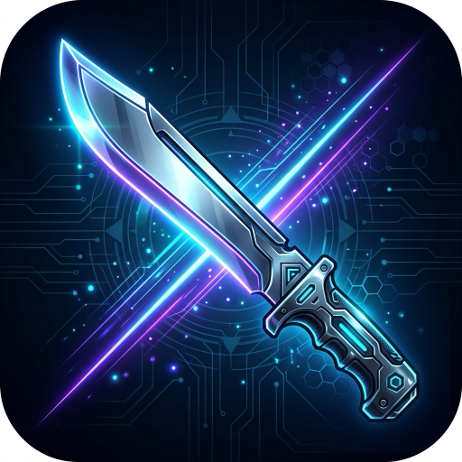

# Machete PS5SD: Image & Video Studio

**Generación local de Imágenes y Video impulsada por IA en la GPU de PlayStation 5**  
*Basado en `stable-diffusion.cpp`, ggml-vulkan sobre RADV, con interfaz web responsive y dashboard en TV.*

[-purple.svg)](#requisitos)

---

## 📌 ¿Qué es Machete PS5SD?

**Machete PS5SD** es una suite completa y autónoma de inteligencia artificial generativa diseñada específicamente para exprimir los **11.0 GiB de memoria unificada aprovechable** en consolas PlayStation 5 liberadas.

A partir del extraordinario trabajo base de **Darkatek7 / Heel Tobias** en [PS5SD](https://github.com/Darkatek7/PS5SD), esta edición **Machete** expande el sistema con **soporte completo de Generación de Video (Text-to-Video e Image-to-Video)**, detección automática de la IP local de la consola y un código QR en pantalla para conectar cualquier smartphone o PC en un segundo.

---

## 🚀 Nuevas Características (Edición Machete)

### 1. Generación de Video (T2V & I2V)
Soporte completo de difusión temporal en C/C++ y UI para modelos de video sin exceder jamás el límite de 11.0 GiB de RAM:

- **Catálogo Integrado con Descarga en 1-Clic:**
  - **Wan 2.2 TI2V 5B (Q4_K_M):** Máxima fidelidad híbrida (Text-to-Video e Image-to-Video). Resolución nativa recomendada 832x480 / 480x832. Incluye Text Encoder UMT5-XXL y Wan VAE.
  - **Wan 2.1 T2V/I2V 1.3B (Q8_0):** Modelo ligero, ultra estable y rápido. Reutiliza los mismos pesos de UMT5 y VAE sin duplicar descargas en disco.
  - **LTX-Video 2B (Q8_0):** Modelo destilado de alta velocidad para secuencias cinemáticas en solo 8–12 pasos a 24 FPS.
- **Paridad Total de Opciones:**
  - **Image-to-Video (I2V):** Permite subir una imagen inicial o pulsar el botón **"Animate this image"** en cualquier resultado de la galería o lightbox para animarlo directamente.
  - **Selector de Frames (Regla $4k+1$):** Ajustes seguros preconfigurados (`17`, `33`, `49` y `65` fotogramas).
  - **Controles Avanzados:** FPS (`16` o `24 fps`), `Flow Shift` (3.0 a 5.0), `Motion Strength` para I2V, `CFG Scale`, `Steps`, `Seed` y samplers (`Euler`, `UniPC`).
  - **Soporte de LoRAs de Video:** Selección dinámica de múltiples LoRAs compatibles con control de fuerza (`strength`).
- **Gestión Crítica de Memoria:**
  - Decodificación temporal del VAE por bloques espaciales (`--vae-tiling` con `--vae-tile-size 512`).
  - Descarga secuencial de memoria del Text Encoder (`umt5-xxl`) inmediatamente tras calcular los embeddings del prompt.
  - Optimización de atención espacio-temporal (`--flash-attn`).
  - Empaquetado automático del resultado como `.mp4` y `.webm` reproducible nativamente en la web y en la galería.

### 2. TV Dashboard Inteligente y Conexión Instantánea por QR
- **Detección Automática de IP Real:** El dashboard en la TV consulta la tabla de enrutamiento del kernel de Prospero/FreeBSD mediante sockets UDP y sondeo de `getifaddrs`, mostrando de inmediato la dirección IPv4 real asignada por DHCP en lugar del marcador genérico `<console ip>`.
- **Código QR Interactivo en Pantalla:** Al lado derecho de la URL `http://<ip>:<puerto>`, se genera un código QR nítido y de alto contraste en GPU. Basta con apuntar la cámara de un smartphone para ingresar directamente a la aplicación web sin tipear la dirección.
- **Auto-Login:** Si el servidor tiene **API Key** activada, el código QR incluye el token de sesión (`#key=...`) y el navegador móvil inicia sesión de forma automática y transparente.

### 3. Suite Completa de Imagen (PS5SD 0.4.0)
- **Hires Fix:** Segunda pasada en alta resolución en la pestaña Create con upscalers latentes o modelos ESRGAN.
- **Upscaling 4x:** Botón directo de escalado con modelos Real-ESRGAN guardando automáticamente el resultado en la galería.
- **Subida y Descarga:** Soporte para archivos `.gguf`, `.safetensors`, `.pth`, `.pt` y `.bin` tanto desde la interfaz web como mediante enlaces de Hugging Face y Civitai.

---

## 📋 Requisitos

- Consola PlayStation 5 liberada en firmware **7.00 a 13.60**, con:
  - [etaHEN](https://github.com/LightningMods/etaHEN) y kstuff-lite.
  - ShadowMountPlus.
  - elfldr (puerto 9021).
  - Servidor FTP (`ftpsrv` en puerto 2121) opcional (la aplicación incluye una copia local en `127.0.0.1:2122` para transferencias mayores a 1.4 GB sin limitación de velocidad del SO).
- Un PC o smartphone en la misma red Wi-Fi o Ethernet que la consola para acceder al Web UI.

---

## 📥 Instalación

1. Descarga el paquete de lanzamiento `PPSA99576.zip`.
2. Descomprime la carpeta `PPSA99576` dentro de `/data/homebrew/` en la consola PS5.
3. Actualiza la lista de aplicaciones con ShadowMountPlus o instálalo desde la tienda Homebrew Store.
4. Lanza **Machete PS5SD** desde el menú principal de la consola.
5. Escanea el código QR que aparece en tu televisor con tu teléfono ¡y listo!

---

## 🛠️ Parámetros de Red y Entorno (`env.txt`)

Puedes personalizar el comportamiento creando o editando `/data/PS5SD/env.txt`:

| Variable | Descripción | Valor por Defecto |
|---|---|---|
| `PS5SD_IP` / `PS5SD_ADDRESS` | Forzar una dirección IP específica en el dashboard | Auto-detectada |
| `PS5SD_PORT` | Puerto de escucha del servidor HTTP y Web UI | `7860` |
| `PS5SD_DL_CONNECTIONS` | Conexiones paralelas para descargas de modelos | `16` |
| `PS5SD_DL_PIECE_MIB` | Tamaño de fragmento para descargas concurrentes | `8` |

---

## 🤝 Créditos y Agradecimientos

Este proyecto es una evolución y fork activo del trabajo de la comunidad homebrew:

- **[Darkatek7 / Heel Tobias (PS5SD)](https://github.com/Darkatek7/PS5SD):** Creador y arquitecto original del proyecto base PS5SD. Su extraordinario trabajo en el harness nativo, el servidor HTTP, el cargador de modelos y la integración con la GPU de PS5 es el cimiento de este proyecto.
- **[leejet / stable-diffusion.cpp](https://github.com/leejet/stable-diffusion.cpp):** Motor de inferencia C/C++ de alto rendimiento para Stable Diffusion, Flux y modelos Wan/LTX.
- **[ggerganov / ggml](https://github.com/ggml-org/ggml):** Tensor library y backend Vulkan.
- **[cobanov / PS5LM](https://github.com/cobanov/PS5LM):** Proyecto pionero de LLMs en PlayStation 5 que inspiró la arquitectura de memoria directa.
- **[mihawk-99 / PS5_Vulkan & PS5_Mesa](https://github.com/mihawk-99/PS5_Vulkan):** Driver stack Vulkan y capa RADV para PlayStation 5.
- **[blackbearreloaded & Phononenom / ps5-homebrew-ui](https://github.com/Phononenom/ps5-homebrew-ui):** Framework gráfico 2D acelerado por hardware para los menús en TV.
- **[Project Nayuki (QR Code generator)](https://www.nayuki.io/page/qr-code-generator-library):** Generador de códigos QR embebido en C++ (MIT).
- **[Marca Machete & VenezuelanBiggie24](https://github.com/VenezuelanBiggie24/PS5SD-IMG-and-VID):** Desarrollo e integración del pipeline completo de Video (T2V/I2V), auto-detección de red, generador QR en TV y adaptación estética de la suite.

---

## 📄 Licencia

Machete PS5SD se distribuye bajo la licencia **GNU General Public License v3.0 or later (GPL-3.0-or-later)**.  
Consulta el archivo [LICENSE](LICENSE) para más información. Los componentes de terceros preservan sus respectivas licencias originales.
